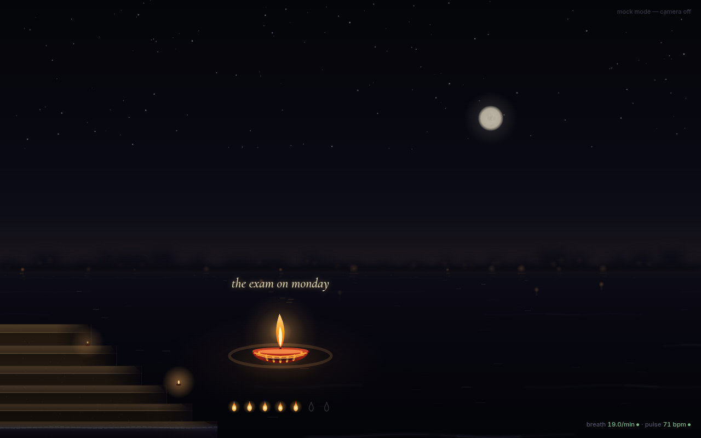
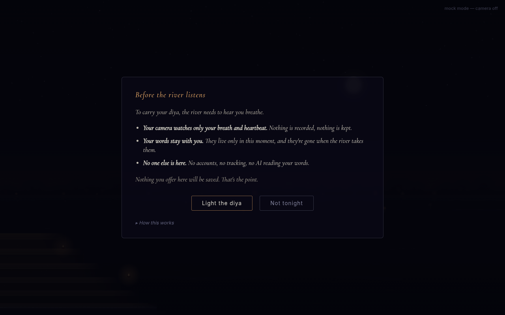
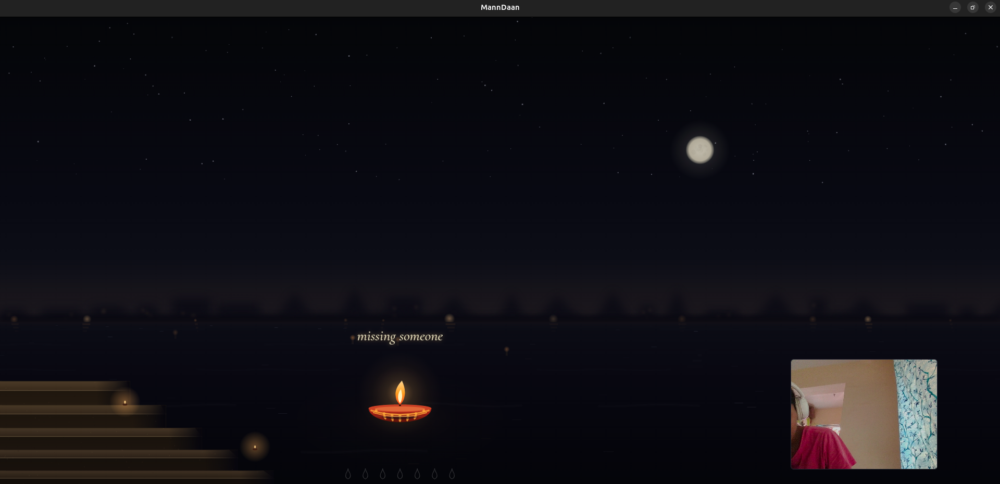
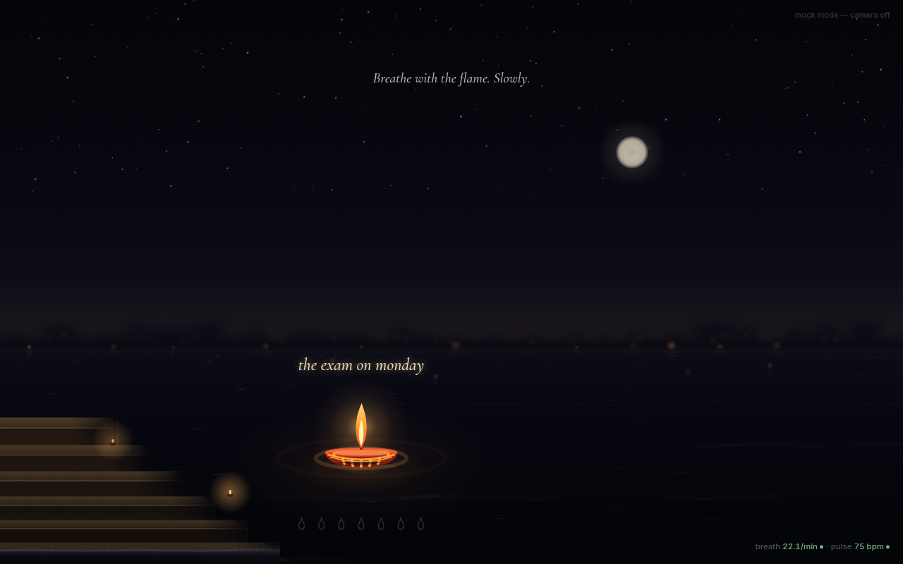

# MannDaan (मन दान)

*An offering from the heart. Offer what weighs on your mann. Seven breaths. One diya.*

Every evening at the ghats of Varanasi, people float a lit diya on the Ganga with
a wish or a worry, *deepdaan*. You cannot do that from a hostel room at 2 AM
before an exam.

MannDaan brings the ritual to your desk. You write down the one thing weighing on
your *mann*, it appears on a diya at the edge of a night ghat, and then **your
breathing decides whether the river accepts it**. Your breath is read from your
webcam, live, by the [Presage SmartSpectra SDK](https://github.com/Presage-Security/SmartSpectra).
Rush, and the current pushes the diya back: *"Ganga doesn't take what you're still
holding."* Breathe slowly for seven breaths, and it floats away downstream while
your words dissolve into the water like ink.

Then it tells you the truth: **nothing was saved. That was the point.**

MannDaan is a ritual, not a health tool. The thresholds are game mechanics ,
"calm enough for the river", not judgements about you, and nothing it measures
is kept.



<table>
<tr>
<td width="50%"><br><sub><b>Consent first.</b> The camera cannot be acquired until you press "Light the diya".</sub></td>
<td width="50%"><br><sub><b>Live, from the camera.</b> The preview stays on screen the whole time, so you can see exactly what the SDK sees.</sub></td>
</tr>
<tr>
<td width="50%"><br><sub><b>One worry.</b> It lives in memory only, and is wiped when the river takes it.</sub></td>
<td width="50%"><br><sub><b>Seven calm breaths.</b> The diya floats away and the words dissolve into the water.</sub></td>
</tr>
</table>

## Run it

```bash
npm install
cp .env.example .env     # add your API key from https://physiology.presagetech.com
npm start
```

The camera stays off until you choose "Light the diya". Press `m` at any time to
mute the ambience.

**For the best reading:** face a window or a lamp, and sit back far enough that
your head *and* chest are in frame: breathing is measured from chest movement.
The app guides you through this before the ritual starts.

Without an API key or a camera, `npm run dev` runs the whole ritual on a
simulated breath. Press `↑`/`↓` to breathe faster or slower, `e` for an erratic
breath, `r` to release, `p` to be pushed back (add `--dev` or use
`npm run dev:debug` to see those hints on screen).

| Script | What it does |
|---|---|
| `npm start` | the real thing: live camera, live breathing |
| `npm run dev` | mock breath, no camera, no API key, no credits |
| `npm run camera:reset` | restores a webcam's automatic exposure (see *Known issues*) |
| `npm run smoke` | runs the whole ritual unattended, for regression checks |

### Linux: Electron's sandbox helper

`npm install` cannot make Electron's `chrome-sandbox` helper setuid-root, so on
Linux the first run may abort with *"The SUID sandbox helper binary was found,
but is not configured correctly"*. Fix it once (this keeps Chromium's sandbox on):

```bash
sudo chown root:root node_modules/electron/dist/chrome-sandbox
sudo chmod 4755 node_modules/electron/dist/chrome-sandbox
```

If you cannot use `sudo`, `npm run start:nosandbox` runs the same app with
Chromium's OS-level sandbox disabled.

## How it uses SmartSpectra

| What | Where |
|---|---|
| SDK bound to the window, camera permission gated on consent | [`main.js`](main.js) |
| Live adapter: starts the camera, decodes metrics, maps validation codes to on-screen guidance, restores the camera afterwards | [`src/renderer/js/signals/live.js`](src/renderer/js/signals/live.js) |
| The mechanic: detects breath cycles and decides calm vs rushed | [`src/renderer/js/breathgate.js`](src/renderer/js/breathgate.js) |
| The scene, driven by the live signals | [`src/renderer/js/scene.js`](src/renderer/js/scene.js) |

Two live signals drive the piece:

- **`metrics.breathing.upperTrace`**, the chest trace. This is what the flame
  follows, breath by breath, and what the seven-breath gate counts. The trace
  moves immediately, while the averaged rate is still settling.
- **`metrics.breathing.rate`** and **`metrics.cardio.pulseRate`**: shown live in
  the corner with the SDK's own `stable` flag (● stable, ○ still settling), so
  what you see on screen is what the SDK actually reported. Pulse also drives the
  shimmer on the water.

We request only `breathingMetrics` plus `MetricType.PULSE_RATE`, not the whole
`cardioMetrics` bundle, which also contains `ARTERIAL_PRESSURE_TRACE` and `HRV`.
That is both a smaller privacy surface and a necessity; see *Known issues*.

## Consent and Data Handling

**The camera is off until you consent.** The consent screen explains what is
read, and the main process refuses every camera request until you press "Light
the diya" ([`main.js`](main.js)). It is locked again as soon as the ritual ends.

**What you write is never stored.** The worry you type lives in a single
JavaScript string in memory. It is never written to disk, logs, `localStorage`, or
any server, and it is overwritten and cleared the moment the diya is released
([`src/renderer/js/ritual.js`](src/renderer/js/ritual.js), `_wipeWorry`).

**No video is recorded.** Frames go from the camera to the SDK and are discarded.
MannDaan never writes an image, never uploads one, and keeps no history of a
session, not even the breathing numbers. Closing the app leaves nothing behind.

**No accounts, no analytics, no AI services.** MannDaan has no backend of its own.

**SDK telemetry is disabled.** We pass `enableTelemetry: false`
([`live.js`](src/renderer/js/signals/live.js)). With it off, Presage's own
documentation states the SDK "starts no telemetry session and transmits nothing".
Were it enabled, it would send session summaries and device diagnostics ,
see Presage's [Telemetry and Privacy](https://github.com/Presage-Security/SmartSpectra/blob/main/docs/telemetry-and-privacy.md).

**Where measurement happens.** On your device. Presage's documentation states
*"On-device processing for iOS, Android, C++ and Node.js"*
([smartspectra.presagetech.com](https://smartspectra.presagetech.com/)), and the
SDK README refers to *"the vitals the SDK computes on-device"*. The SDK contacts
Presage's servers to validate your API key and report usage against your credit
allowance.

**The camera is handed back.** The SDK locks the webcam's exposure while it
measures. MannDaan restores automatic exposure before it releases the camera, and
the app will not finish quitting until it has (see *Known issues*).

## What the app handles for you

These were real problems during development. They are fixed in code, and the
fixes are the interesting part of the build, the story is in [NOTES.md](NOTES.md).

- **Your camera is given back the way it was found.** The SDK locks the webcam's
  exposure while measuring, and on Linux that outlives the process, which once
  left every other app on the machine, video calls included, with a dark picture.
  MannDaan restores automatic exposure before releasing the camera, and the app
  will not finish quitting until it has, including on `SIGTERM`.
- **Measurement recovers by itself.** When conditions slip, the SDK stops with a
  retryable error. Rather than ending your ritual with a console message, the
  pipeline is rebuilt and the ritual carries on.
- **The capture size is chosen for real webcams.** We request 640x480 instead of
  the SDK's default 1280x720, which many laptop cameras cannot hold at 30 fps.
- **The scene gets out of the way.** The vitals pipeline needs roughly half a
  core. When the SDK reports it is short of frames, the artwork drops its most
  expensive effects and its frame budget until the measurement recovers.
- **The screen becomes a lamp.** If the SDK reports the frame is too dark, the
  diya's glow swells across the screen and throws light back at your face.

## Credits

- **SmartSpectra SDK** © Presage Technologies, used as an npm dependency under
  its own licence.
- **Fonts** (in `src/renderer/fonts/`, all SIL Open Font License 1.1, licence
  texts alongside the files):
  [Cormorant Garamond](https://fonts.google.com/specimen/Cormorant+Garamond) ©
  the Cormorant Project Authors;
  [Inter](https://fonts.google.com/specimen/Inter) © the Inter Project Authors;
  [Tiro Devanagari Hindi](https://fonts.google.com/specimen/Tiro+Devanagari+Hindi)
  © the Indigo Project Authors.
- The night ghat, the water, the diya and the flame are all drawn in Canvas 2D ,
  no images, no sprites from anywhere else.
- **Sound is synthesized in the Web Audio API**
  ([`src/renderer/js/audio.js`](src/renderer/js/audio.js)), no audio files, so
  nothing to license. The river is filtered brown noise; the temple bells are
  inharmonic partials through a generated reverb, struck once every eight
  heartbeats from the live pulse. Press `m` to mute.

## License

MIT: see [LICENSE](LICENSE). Covers this app's code only; the SmartSpectra SDK is
a dependency under its own terms.
